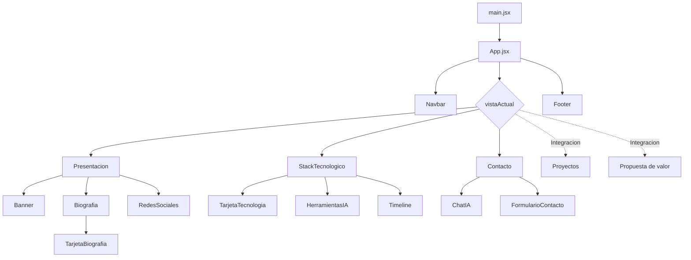
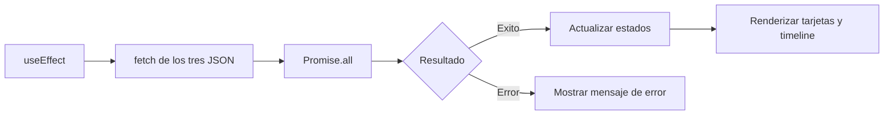
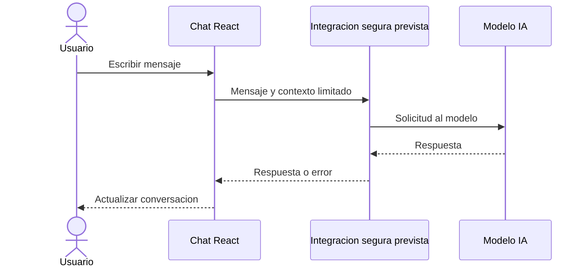

# Portafolio personal | React + Vite

Aplicación web académica para presentar un perfil profesional, consultar proyectos, conocer habilidades y establecer contacto mediante un formulario y un asistente conversacional.

**Institución Universitaria Antonio José Camacho · Tecnología en Sistemas de Información · Desarrollo de Apps asistido con IA · Grupo 711**

**Autores:** Juan Guillermo Sánchez y Samuel Beltrán Dávila.

**Estado:** en desarrollo — interfaz de las tres vistas de Juan desarrollada; integración de IA y revisión conjunta pendientes.

## Contenido

- [Objetivo y alcance](#objetivo-y-alcance)
- [Tecnologías](#tecnologías)
- [Instalación y ejecución](#instalación-y-ejecución)
- [Arquitectura](#arquitectura)
- [Módulos y funcionamiento](#módulos-y-funcionamiento)
- [Diseño y navegación](#diseño-y-navegación)
- [Inteligencia artificial](#inteligencia-artificial)
- [Pruebas](#pruebas)
- [Organización del desarrollo](#organización-del-desarrollo)
- [Estado y próximos pasos](#estado-y-próximos-pasos)

## Objetivo y alcance

Construir un portafolio web que centralice información profesional y facilite la consulta de proyectos, tecnologías, experiencia y canales de contacto. El proyecto aplica los fundamentos de JavaScript, React y desarrollo asistido por inteligencia artificial estudiados en la asignatura.

El alcance comprende cinco vistas, navegación sin recarga completa de página, componentes reutilizables, carga asíncrona de datos, validación de formularios y una futura conexión real con un modelo de IA. No se contempla autenticación, administración de usuarios ni almacenamiento remoto de contactos en la implementación actual.

## Tecnologías

| Tecnología | Uso |
| --- | --- |
| React | Componentes funcionales, props, estados y efectos. |
| Vite | Servidor de desarrollo y compilación. |
| JavaScript (ES6+) | Funciones flecha, objetos, arreglos, eventos y promesas. |
| JSX | Estructura de las interfaces. |
| CSS | Diseño visual, Flexbox, Grid y adaptación a pantallas. |
| JSON | Datos de tecnologías, herramientas de IA y experiencias. |
| Fetch API | Lectura asíncrona de archivos JSON. |
| Git y GitHub | Control de versiones y colaboración. |
| npm | Gestión de dependencias y scripts. |

El boilerplate documentado utiliza React `^19.1.0` y Vite `^6.3.5`. Las versiones definitivas son las declaradas en `package.json` y `package-lock.json` del repositorio integrado.

## Instalación y ejecución

### Requisitos

- Git.
- Node.js compatible con la versión de Vite del proyecto (se recomienda Node.js 22 LTS).
- npm.

### Desarrollo local

```bash
git clone https://github.com/Guillermo18-cpu/Proyecto-final-react.git
cd Proyecto-final-react
npm install
npm run dev
```

Abrir la URL indicada por Vite, normalmente `http://localhost:5173/`. Para consultar el avance de Juan antes de la integración, si la rama está publicada:

```bash
git switch guillermo
npm install
npm run dev
```

### Scripts

| Comando | Descripción |
| --- | --- |
| `npm run dev` | Inicia el servidor local. |
| `npm run build` | Genera la compilación de producción en `dist/`. |
| `npm run preview` | Previsualiza la compilación local. |
| `npm run lint` | Ejecuta la revisión de ESLint. |

La interfaz actual no necesita una API key para iniciar. La configuración de IA se documentará cuando se defina el mecanismo de integración en clase.

## Arquitectura

La aplicación separa las vistas, los componentes reutilizables, los recursos visuales y los datos. `App.jsx` administra la vista activa mediante `useState` y renderizado condicional; `Navbar` y `Footer` son componentes compartidos.

### Estructura del avance de Juan

```text
Proyecto-final-react/
├── public/
│   ├── datos/
│   │   ├── tecnologias.json
│   │   ├── herramientasIA.json
│   │   └── experiencias.json
│   └── imagenes/
│       ├── react.svg
│       ├── javascript.svg
│       └── sql.svg
├── src/
│   ├── assets/
│   │   └── perfil.jpg
│   ├── components/
│   │   ├── Navbar.jsx
│   │   ├── Banner.jsx
│   │   ├── Biografia.jsx
│   │   ├── TarjetaBiografia.jsx
│   │   ├── RedesSociales.jsx
│   │   ├── Footer.jsx
│   │   ├── TarjetaTecnologia.jsx
│   │   ├── HerramientasIA.jsx
│   │   ├── Timeline.jsx
│   │   ├── ChatIA.jsx
│   │   └── FormularioContacto.jsx
│   ├── views/
│   │   ├── Presentacion.jsx
│   │   ├── StackTecnologico.jsx
│   │   └── Contacto.jsx
│   ├── App.jsx
│   ├── index.css
│   └── main.jsx
├── package.json
└── README.md
```

La estructura de proyectos y propuesta de valor se incorporará después de revisar la rama de Samuel; no se asignan nombres de archivos no confirmados.

### Diagrama de componentes



## Módulos y funcionamiento

### 1. Presentación y biografía

Punto de entrada del portafolio. Incluye banner con imagen y descripción del perfil, biografía con tres elementos, dos enlaces sociales, navbar y footer. Los botones **Ver proyectos** y **Contáctame** cambian la vista mediante la función recibida por props.

| Componente | Responsabilidad |
| --- | --- |
| `Presentacion` | Agrupa las secciones de inicio. |
| `Banner` | Presentación, fotografía y llamadas a la acción. |
| `Biografia` | Define el arreglo de información biográfica. |
| `TarjetaBiografia` | Renderiza cada elemento mediante props. |
| `RedesSociales` | Genera enlaces externos a partir de un arreglo. |
| `Navbar` / `Footer` | Navegación y resumen compartidos. |

Pendiente: confirmar el enlace personal de LinkedIn y el contenido definitivo del perfil.

### 2. Proyectos

Módulo a cargo de Samuel. Su alcance funcional se define según el enunciado:

- Mostrar inicialmente diez proyectos y permitir navegar entre páginas de diez elementos.
- Representar cada proyecto en una tarjeta con cinco atributos obligatorios.
- Abrir un sidebar con los ocho atributos del proyecto seleccionado.
- Filtrar por dos atributos; uno mediante selector y el otro de libre elección.
- Incorporar acciones de Filtrar y Limpiar filtros.

Flujo previsto: cargar proyectos → aplicar filtros → paginar resultados → seleccionar proyecto → visualizar detalle. Los nombres de atributos, componentes y estado real se confirmarán al integrar la rama correspondiente.

### 3. Stack tecnológico y estudios

Presenta tecnologías con imágenes y descripciones, herramientas de IA y tres experiencias laborales en una línea de tiempo.

`StackTecnologico` carga los tres archivos JSON mediante `fetch` dentro de `useEffect`. Una función `cargarDatos` comprueba la respuesta HTTP y la convierte a datos JavaScript. `Promise.all` reúne las tres peticiones; los resultados se almacenan con `useState` y se distribuyen mediante props. Durante la carga se muestra un aviso; si falla una petición se muestra un error general.



| Archivo | Propiedades de cada objeto |
| --- | --- |
| `tecnologias.json` | `id`, `nombre`, `categoria`, `descripcion`, `imagen` |
| `herramientasIA.json` | `id`, `nombre`, `descripcion`, `enlace` |
| `experiencias.json` | `id`, `empresa`, `cargo`, `periodo`, `descripcion` |

El contenido inicial incluye React, JavaScript y SQL, y las herramientas ChatGPT y GitHub Copilot. Las experiencias laborales son datos provisionales que deben sustituirse por información real antes de entregar.

### 4. Chat de conversación y formulario de contacto

`Contacto.jsx` reúne dos componentes independientes en una sola vista.

#### Formulario de contacto

`FormularioContacto` administra los campos mediante un objeto de estado, captura los cambios con `onChange` y valida los datos al ejecutar `onSubmit`. Se utilizan expresiones regulares, `trim()` y mensajes de error por campo.

| Campo | Regla |
| --- | --- |
| Nombre | Obligatorio, letras (incluidas tildes y ñ) y espacios, máximo 20 caracteres. |
| Apellidos | Misma regla que nombre. |
| Correo | Obligatorio, formato básico de correo válido. |
| Teléfono | Obligatorio, únicamente dígitos. |
| Descripción | Obligatoria, no admite solo espacios. |

Si todos los datos son válidos, se muestra una confirmación local y se limpian los campos. No se envían correos ni se persisten los datos. Actualmente los caracteres inválidos se rechazan al validar el envío, no necesariamente al escribir; debe verificarse si el docente exige impedir su ingreso desde el teclado.

#### Chat de conversación

`ChatIA` mantiene un arreglo de mensajes en `useState`. Cada mensaje contiene `id`, `rol` y `contenido`. El componente muestra un saludo inicial, permite escribir y agregar mensajes del usuario, rechaza mensajes vacíos y permite limpiar la conversación. La interfaz distingue visualmente los roles.

El historial actual permanece mientras el componente está montado; se pierde al salir de la vista o recargar. No hay respuestas generadas por un modelo todavía. La conexión real y la gestión compartida del historial quedan pendientes de la explicación del docente.

### 5. Propuesta de valor

Módulo a cargo de Samuel. El diseño previsto incluye una sección principal con carrusel, una segunda sección de contenido profesional y el footer compartido. El contenido y funcionamiento definitivo se documentarán tras revisar su implementación.

## Diseño y navegación

La línea visual utiliza azul primario (`#2563eb`), azul oscuro (`#0f172a`), fondo claro (`#f8fafc`) y blanco (`#ffffff`). Se emplean tarjetas con bordes suaves, tipografía del sistema y una distribución adaptable mediante CSS Grid, Flexbox y media queries de 768 px.

| Opción del navbar | Estado de navegación |
| --- | --- |
| Inicio | `inicio` |
| Proyectos | `proyectos` |
| Stack tecnológico | `stack` |
| Propuesta de valor | `propuesta` |
| Contacto | `contacto` |

El estado `vistaActual` permite cambiar el contenido principal sin recargar el documento. No se utiliza React Router en el avance descrito. Los botones del banner emplean la misma función de navegación.

## Inteligencia artificial

### Integración prevista

La selección del proveedor, modelo, configuración y mecanismo de conexión se realizará según la explicación del docente. El flujo previsto es:



Este diagrama representa el diseño objetivo, no una conexión ya operativa.

### Prompt engineering

Propuesta inicial de instrucciones RTCF, pendiente de ajuste al modelo seleccionado:

```text
Rol: asistente virtual del portafolio profesional.
Contexto: utiliza únicamente los datos verificados del perfil y sus proyectos.
Tarea: responde preguntas sobre habilidades, experiencia, proyectos y contacto.
Restricciones: no inventes información; no solicites datos sensibles;
si no conoces una respuesta, indícalo y orienta al formulario de contacto.
Formato: respuesta breve, clara y en español.
```

### Optimización de tokens y seguridad

- Enviar únicamente contexto relevante y limitar la longitud de entrada y salida.
- Limitar o resumir el historial enviado al modelo sin eliminar necesariamente el historial visible.
- Evitar solicitudes vacías y gestionar carga, errores y respuestas del proveedor.
- No incluir claves privadas en el código del navegador, archivos públicos ni commits. Las variables `VITE_*` se exponen al cliente y no son adecuadas para secretos.
- Definir una integración segura según las instrucciones del docente y documentar las variables necesarias sin publicar sus valores.

`useContext` está previsto para gestionar estado compartido si corresponde al diseño explicado en clase. Todavía no se encuentra implementado en el avance descrito.

## Pruebas

La siguiente matriz define comprobaciones manuales de aceptación. No constituye un reporte de pruebas automatizadas ni una certificación de ejecución completa.

| Caso | Resultado esperado | Estado |
| --- | --- | --- |
| Navegar desde Inicio a Stack | Se muestra la vista seleccionada | Observado en captura |
| Cargar tecnologías | Tres tarjetas con imágenes y descripción | Observado en captura |
| CTA y enlaces sociales | Navegación y perfiles correctos | Verificar enlaces finales |
| Cargar herramientas y timeline | Dos herramientas y tres experiencias | Verificar y personalizar |
| JSON inexistente o inválido | Mensaje de error sin bloquear toda la aplicación | Por probar |
| Formulario vacío | Errores de campos obligatorios | Por probar |
| Nombre con números o teléfono con letras | Rechazo del envío | Por probar |
| Correo incorrecto | Mensaje de validación | Por probar |
| Formulario válido | Confirmación local y limpieza | Por probar |
| Chat con mensaje vacío | No se agrega al historial | Por probar |
| Chat con varios mensajes | Se conservan mientras la vista está montada | Por probar |
| Limpiar chat | Regresa al saludo inicial | Por probar |
| Pantalla móvil | Distribución en una columna sin desbordamiento | Por probar |
| Proyectos: filtros, paginación y detalle | Cumple condiciones del módulo | Pendiente de integración |
| Propuesta de valor | Carrusel, segunda sección y footer | Pendiente de integración |
| API de IA | Respuesta real, historial y manejo de errores | Pendiente de implementación |
| Compilación y lint | Comandos terminan sin errores | Por ejecutar en versión integrada |

## Organización del desarrollo

| Integrante | Responsabilidad acordada |
| --- | --- |
| Juan Guillermo Sánchez | Presentación y biografía, stack tecnológico y estudios, chat y formulario de contacto, README. |
| Samuel Beltrán Dávila | Listado de proyectos, filtros, paginación, detalle y propuesta de valor. |
| Ambos | Integración, revisión, pruebas, diapositivas y sustentación. |

Ramas de trabajo: `guillermo` y `feature/samuel-estudiante2`. La integración en `main` debe coordinarse entre los integrantes para evitar sobrescribir cambios.

Flujo recomendado: revisar requisitos → definir componentes y datos → implementar por módulos → verificar → documentar cambios → integrar. Este README consolida el diseño y el avance existente; no pretende acreditar que todas las decisiones se documentaron antes de programar.

## Estado y próximos pasos

- [x] Estructura base React + Vite.
- [x] Implementación inicial de presentación y biografía.
- [x] Implementación inicial de stack tecnológico y estudios.
- [x] Formulario con validaciones y confirmación local.
- [x] Interfaz de chat e historial temporal.
- [ ] Personalizar experiencias y comprobar enlaces sociales.
- [ ] Revisar e integrar proyectos y propuesta de valor de Samuel.
- [ ] Implementar conexión real con IA y `useContext` según clase.
- [ ] Completar pruebas, corregir errores y actualizar documentación de ejecución de IA.
- [ ] Preparar diapositivas y demo de sustentación.

## Referencias

- Enunciado oficial: *Proyecto Final — Desarrollo de Apps asistido con IA*, grupo 711, secciones 2, 4, 5 y 6.
- [Documentación de React](https://react.dev/)
- [Documentación de Vite](https://vite.dev/)
- [MDN Web Docs](https://developer.mozilla.org/es/)

El desarrollo se apoya en herramientas de IA para orientación, explicación y revisión de código. Los integrantes son responsables de comprender, comprobar y sustentar la implementación entregada.
