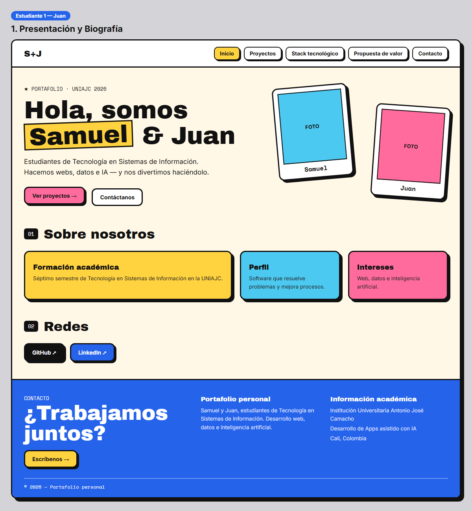
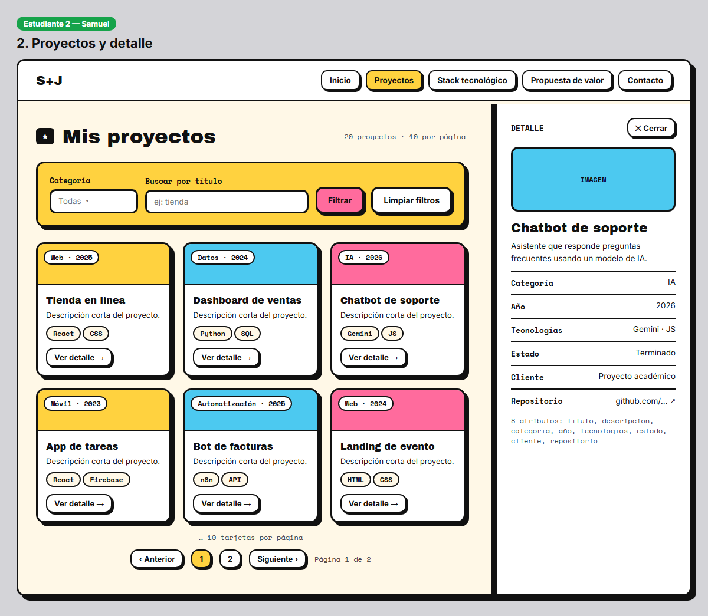
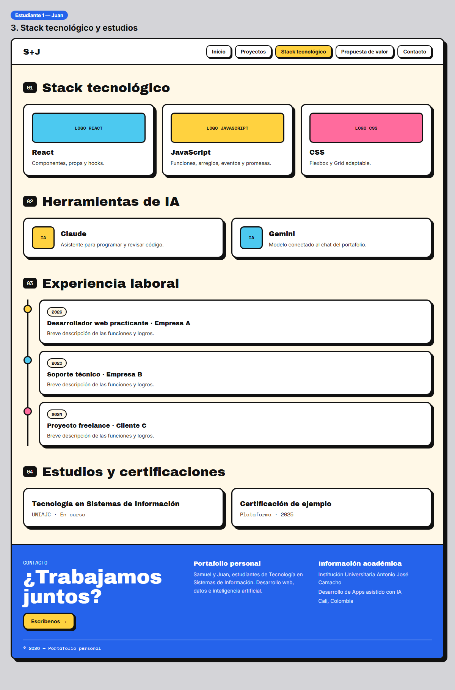
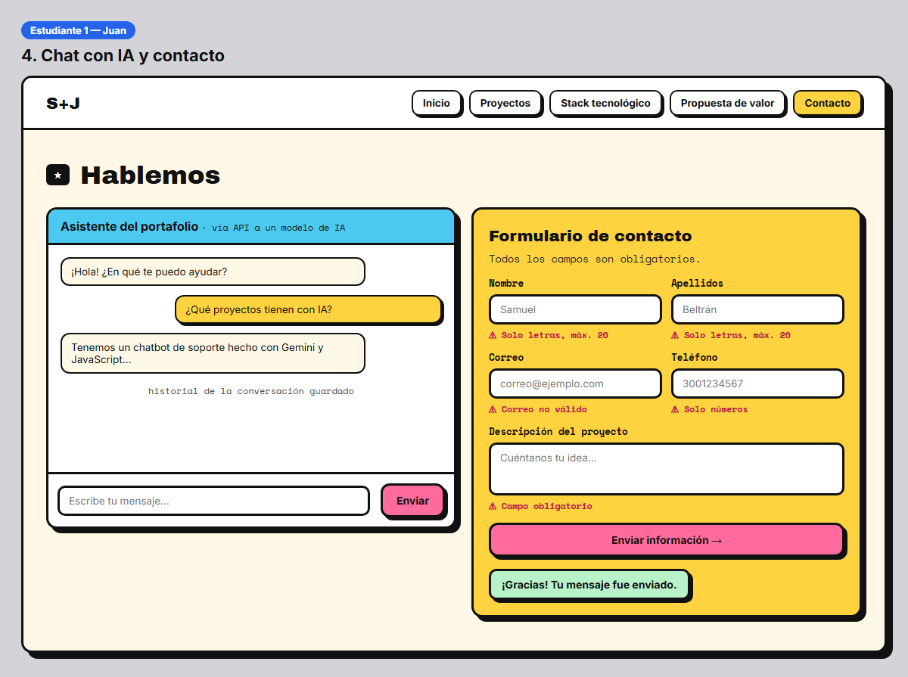
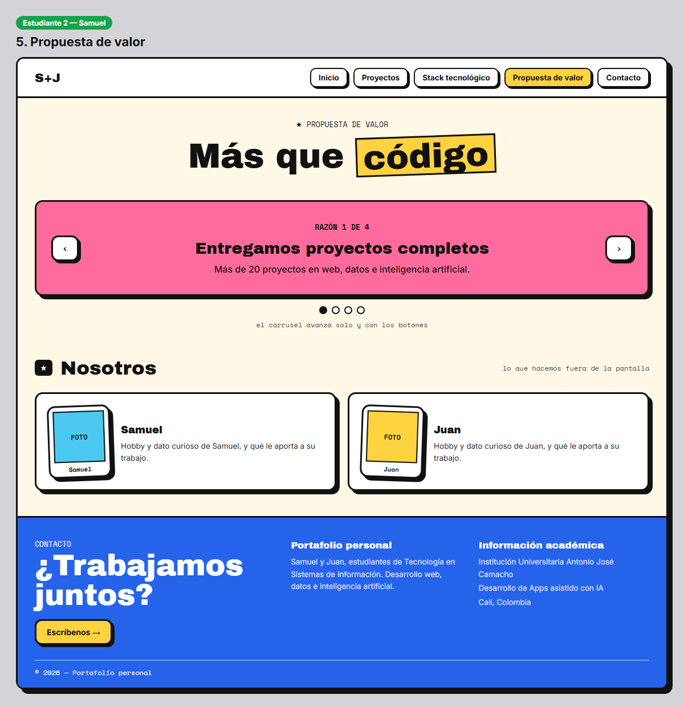

# Maquetación — Portafolio (Proyecto final React)

Maquetación de las 5 vistas, basada en las secciones 4 y 5 de `Proyecto.pdf` y en lo indicado por el profesor en clase. Cada vista tiene su imagen con la línea de diseño (estilo neobrutalista) y un esquema con la ubicación de cada sección.

**Reparto (diagrama del PDF):**

- **Estudiante 1 — Juan:** Presentación y Biografía, Stack tecnológico, Chat y contacto.
- **Estudiante 2 — Samuel:** Proyectos y detalle, Propuesta de valor.

---

## 1. Presentación y Biografía — Juan



```
┌──────────────────────────────────────────────────────────────┐
│ HEADER: [Logo/Nombre]   Inicio | Proyectos | Stack | Chat | Propuesta │
├──────────────────────────────────────────────────────────────┤
│ BANNER                                                        │
│  ┌──────┐  Título: Hola, somos [Nombres]                      │
│  │ FOTO │  Descripción del perfil                             │
│  └──────┘  [Ver proyectos]  [Contacto]                        │
├──────────────────────────────────────────────────────────────┤
│ BIOGRAFÍA (mín. 3 elementos)                                  │
│  ┌──────────┐ ┌──────────┐ ┌──────────┐                       │
│  │Elemento 1│ │Elemento 2│ │Elemento 3│                       │
│  └──────────┘ └──────────┘ └──────────┘                       │
├──────────────────────────────────────────────────────────────┤
│ REDES SOCIALES (mín. 2):  (GitHub)  (LinkedIn)                │
├──────────────────────────────────────────────────────────────┤
│ FOOTER: ¿Trabajamos juntos? · resumen · info académica · ©    │
└──────────────────────────────────────────────────────────────┘
```

- "Ver proyectos" lleva a la vista de Proyectos; "Contacto" lleva a la vista de Chat y contacto.

---

## 2. Proyectos y detalle — Samuel



```
┌──────────────────────────────────────────────────────────────┐
│ HEADER + NAVBAR                                               │
├──────────────────────────────────────────────────────────────┤
│ Título: Mis proyectos            (mín. 20 proyectos → 2+ páginas) │
│ FILTROS: [Categoría ▼ = selector]  [Buscar por título = libre]│
│          [Filtrar]  [Limpiar filtros]                         │
├──────────────────────────────────────────────────────────────┤
│ ┌──────────┐ ┌──────────┐ ┌──────────┐                        │
│ │Título    │ │Título    │ │Título    │                        │
│ │Descripc. │ │Descripc. │ │Descripc. │   10 tarjetas          │
│ │Categoría │ │Categoría │ │Categoría │   por página           │
│ │Año       │ │Año       │ │Año       │                        │
│ │Tecnolog. │ │Tecnolog. │ │Tecnolog. │                        │
│ │[Detalle] │ │[Detalle] │ │[Detalle] │                        │
│ └──────────┘ └──────────┘ └──────────┘                        │
│     [< Anterior]  1  2  [Siguiente >]     Página 1 de 2       │
└──────────────────────────────────────────────────────────────┘

                        SIDEBAR (al pulsar "Detalle") →
                        ┌───────────────────┐
                        │ [X Cerrar]        │
                        │ Título            │
                        │ Descripción       │
                        │ Categoría         │
                        │ Año               │
                        │ Tecnologías       │
                        │ Estado            │
                        │ Cliente           │
                        │ Repositorio 🔗    │
                        └───────────────────┘
```

- Al entrar se ven los 10 primeros proyectos.
- **Tarjeta (5 atributos):** título, descripción, categoría, año, tecnologías.
- **Detalle (8 atributos):** los 5 anteriores + estado, cliente, repositorio.
- **Filtrar** aplica categoría y texto; **Limpiar filtros** quita los filtros. En ambos casos se vuelve a la página 1.

---

## 3. Stack tecnológico y estudios — Juan



```
┌──────────────────────────────────────────────────────────────┐
│ HEADER + NAVBAR                                               │
├──────────────────────────────────────────────────────────────┤
│ Título: Stack y estudios                                      │
│ STACK (mín. 3 tarjetas con imagen)                            │
│ ┌────────┐ ┌────────┐ ┌────────┐                              │
│ │ [img]  │ │ [img]  │ │ [img]  │                              │
│ │ React  │ │   JS   │ │  CSS   │                              │
│ │ desc.  │ │ desc.  │ │ desc.  │                              │
│ └────────┘ └────────┘ └────────┘                              │
├──────────────────────────────────────────────────────────────┤
│ HERRAMIENTAS DE IA (mín. 2)                                   │
│ ┌────────────┐ ┌────────────┐                                 │
│ │ [img] IA 1 │ │ [img] IA 2 │                                 │
│ └────────────┘ └────────────┘                                 │
├──────────────────────────────────────────────────────────────┤
│ EXPERIENCIA LABORAL (timeline, mín. 3)                        │
│  ● 2026 — Cargo · Empresa · descripción                       │
│  │                                                            │
│  ● 2025 — Cargo · Empresa · descripción                       │
│  │                                                            │
│  ● 2024 — Cargo · Empresa · descripción                       │
├──────────────────────────────────────────────────────────────┤
│ ESTUDIOS / CERTIFICACIONES                                    │
└──────────────────────────────────────────────────────────────┘
```

---

## 4. Chat con IA y contacto — Juan



```
┌──────────────────────────────────────────────────────────────┐
│ HEADER + NAVBAR                                               │
├──────────────────────────────────────────────────────────────┤
│ Título: Hablemos                                              │
│ CHAT CON IA (conexión vía API a un modelo)                    │
│ ┌──────────────────────────────────────────────────────────┐ │
│ │ 🤖 Hola, ¿en qué te puedo ayudar?                        │ │
│ │                          ¿Qué proyectos tienen? 👤       │ │
│ │ 🤖 Respuesta del modelo...                               │ │
│ │                     (historial de la conversación)       │ │
│ └──────────────────────────────────────────────────────────┘ │
│ [Escribe tu mensaje....................]  [Enviar]          │
├──────────────────────────────────────────────────────────────┤
│ FORMULARIO DE CONTACTO (todos los campos obligatorios)        │
│ Nombre      [______________]  ⚠ Solo letras, máx. 20          │
│ Apellidos   [______________]  ⚠ Solo letras, máx. 20          │
│ Correo      [______________]  ⚠ Correo no válido              │
│ Teléfono    [______________]  ⚠ Solo números                  │
│ Descripción del proyecto                                      │
│ [________________________________________________________]   │
│ [________________________________________________________]   │
│                  [Enviar información]                         │
│ ✅ "¡Gracias! Tu mensaje fue enviado."  (solo si todo es válido) │
└──────────────────────────────────────────────────────────────┘
```

---

## 5. Propuesta de valor — Samuel



```
┌──────────────────────────────────────────────────────────────┐
│ HEADER + NAVBAR                                               │
├──────────────────────────────────────────────────────────────┤
│ Título: Más que código                                        │
│ SECCIÓN PRINCIPAL: CARRUSEL (una razón por diapositiva)       │
│ ┌──────────────────────────────────────────────────────────┐ │
│ │ [<]  Razón: "Entregamos proyectos completos"         [>] │ │
│ │      Prueba: "+20 proyectos en web, datos e IA"          │ │
│ └──────────────────────────────────────────────────────────┘ │
│        ●  ○  ○  ○                                             │
├──────────────────────────────────────────────────────────────┤
│ SECCIÓN SECUNDARIA: Nosotros                                  │
│ ┌──────────────────────────┐ ┌──────────────────────────┐    │
│ │ [foto] Samuel            │ │ [foto] Juan              │    │
│ │ Hobby + dato curioso     │ │ Hobby + dato curioso     │    │
│ └──────────────────────────┘ └──────────────────────────┘    │
│              [¿Trabajamos juntos? → Contacto]                 │
├──────────────────────────────────────────────────────────────┤
│ FOOTER                                                        │
└──────────────────────────────────────────────────────────────┘
```

- **Carrusel:** razones para trabajar con nosotros, cada una con una prueba. Avanza solo cada pocos segundos y con los botones [<] [>].
- **Nosotros:** lo personal de cada uno (hobby, dato curioso), con un botón hacia Contacto.

---

## Navegación general

```
                 ┌──────────────────────┐
                 │ Presentación y Bio   │
                 └──────────┬───────────┘
      ┌──────────────┬──────┴───────┬──────────────┐
      ▼              ▼              ▼              ▼
 ┌─────────┐   ┌──────────┐   ┌──────────┐   ┌──────────┐
 │Proyectos│   │  Stack   │   │   Chat   │   │Propuesta │
 │+ Detalle│   │          │   │+Contacto │   │ de valor │
 └─────────┘   └──────────┘   └──────────┘   └──────────┘
```

Todas las vistas comparten el header con navbar.
